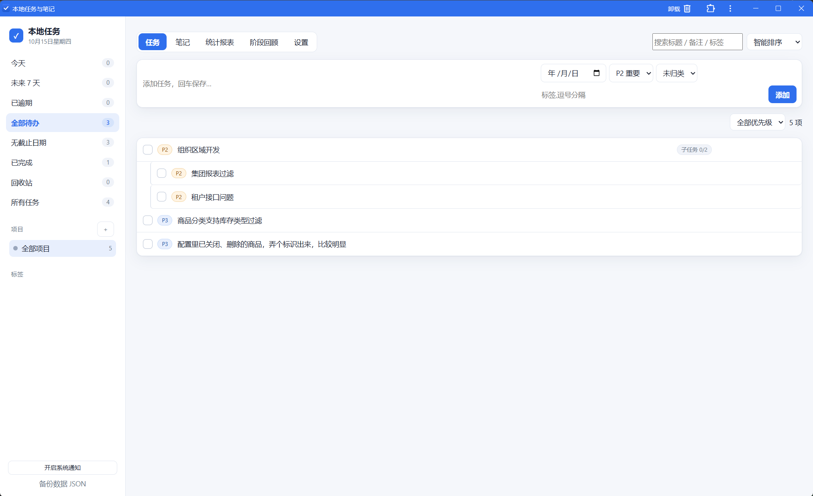
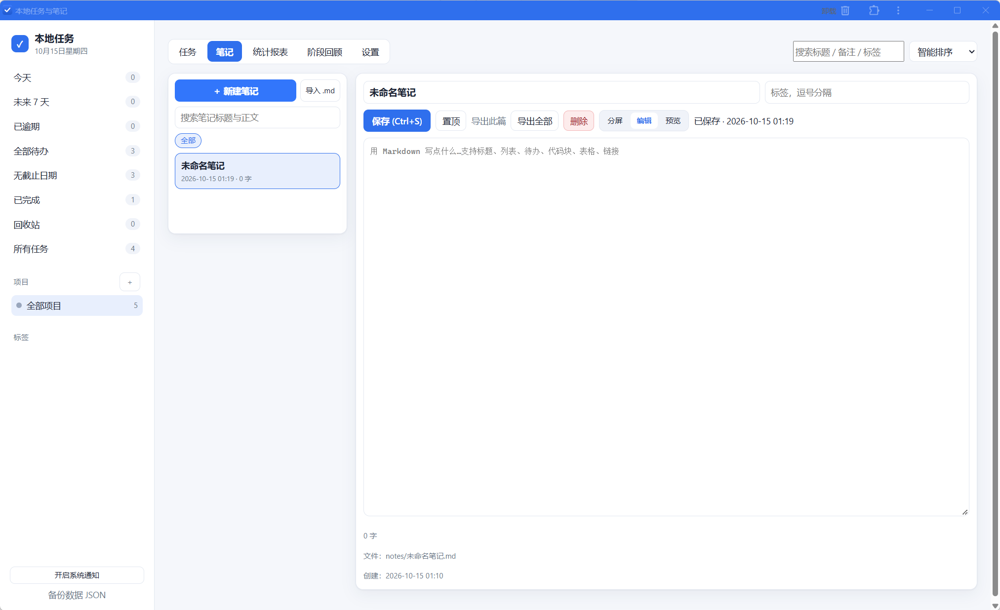

# 本地待办 / 任务管理系统

纯本机运行的任务与笔记工具：零第三方依赖（只用 Node 内置模块），任务存在一个可直接用文本编辑器查看的 JSON 文件里，笔记则是 `notes/` 目录下的 Markdown 文件，界面在浏览器里打开。许可：MIT。

## 界面预览

任务视图（左侧智能视图与项目、顶部快速添加、子任务缩进并显示进度）：



笔记视图（左侧列表与全文搜索、右侧 Markdown 编辑与实时预览，可切分屏/仅编辑/仅预览）：



## 启动

```bash
node server.js          # 或 npm start
```

打开 http://127.0.0.1:8787 即可使用。想先看示例数据：

```bash
TODO_SEED=1 node server.js     # 首次启动时写入 3 个项目 + 8 条演示任务
```

常用参数（环境变量）：

| 变量 | 默认值 | 作用 |
| --- | --- | --- |
| `PORT` | `8787` | 监听端口 |
| `HOST` | `127.0.0.1` | 只监听本机；改成 `0.0.0.0` 可局域网访问 |
| `TODO_DATA_FILE` | `data/tasks.json` | 任务数据文件位置 |
| `TODO_NOTES_DIR` | `notes/` | 笔记 Markdown 目录 |
| `TODO_SEED` | 空 | 设为 `1` 时在空库写入演示数据 |

服务只在你的机器上运行，不联网、不上传任何数据。停止：终端按 `Ctrl+C`。

## 数据在哪

全部状态都在 `data/tasks.json`（首次运行自动创建，写入采用「临时文件 + 改名」，避免写坏）。
备份：直接复制该文件，或点侧栏「备份数据 JSON」/访问 `/api/export`。
换机器：把 `data/tasks.json` 拷到新机器同一路径即可。

笔记每条是一个独立的 `notes/标题.md` 文件，开头带一小段 front matter（id、标题、标签、置顶、创建/更新时间），下面就是普通 Markdown：

- 可以直接用 Obsidian / Typora / VS Code 打开 `notes/` 编辑，回到页面刷新即可看到改动
- 手工丢进 `notes/` 的 .md 文件也会自动出现在笔记列表里（没有 front matter 时按正文一级标题或文件名取标题）
- `notes/` 里以 `.` 或 `_` 开头的文件会被忽略，适合放模板或草稿
- 备份笔记：直接复制整个 `notes/` 目录，或用页面上的「导出全部」下载合并后的单份 Markdown

## 功能

**任务**
- 四个优先级 P1–P4、状态（待办 / 进行中 / 已完成）、备注、标签、所属项目
- 截止日期 + 可选具体时间；不填时间时按「设置 → 视为到期时刻」（默认 23:59）判断逾期
- 子任务：任意任务可加子任务，列表里缩进紧跟父任务，父任务行显示 `子任务 0/2` 进度；勾选父任务不会替你完成子任务
- 项目增删改；删除项目时其中的任务转为「未归类」而不是被删掉

**重复任务**
- 规则：每天 / 每个工作日 / 每周（可选星期几）/ 每月 / 每隔 N 天
- 勾选完成后自动生成下一次实例，并继承优先级、项目、标签、提醒设置；以原到期日为基准向前滚动到不早于今天，所以漏掉几天不会生成一串旧任务
- 子任务不参与重复生成，避免每次完成父任务堆一串副本

**提醒**
- 每个任务可设「提前 N 分钟提醒」，未单独设置时用全局默认值
- 到期/逾期任务出现在页面顶部横幅，可「稍后 1 小时」或「本次不再提醒」
- 页面每 60 秒（可在设置里改）向 `/api/reminders` 轮询；点「开启系统通知」后浏览器会弹系统通知

**统计报表**
- 待办 / 今日到期 / 已逾期 / 已完成 / 完成率 / 连续完成天数
- 近 7、14、30、60 天的新增与完成趋势柱状图
- 按项目的待办与完成分布、待办优先级分布、标签排行

**阶段回顾**
- 本周 / 上周 / 本月 / 近 30 天 / 自定义区间
- 区间完成数、达成率、平均完成周期、最佳单日
- 「未达成 / 顺延清单」和「当前逾期任务」支持一键「改到明天」「顺延 7 天」

**视图与筛选**
- 今天 / 未来 7 天 / 已逾期 / 全部待办 / 无截止日期 / 已完成 / 回收站 / 所有任务
- 按项目、标签、优先级筛选，标题与备注全文搜索，四种排序
- 回收站保留删除的任务（含子任务），可恢复或彻底删除

**笔记**（独立模块，与任务不互相引用）
- 左栏列表 + 右侧编辑器的双栏布局，三种模式：分屏 / 仅编辑 / 仅预览
- Markdown 实时预览：标题、有序/无序与嵌套列表、任务勾选框、引用、代码块（围栏 ``` 或缩进 4 空格，方便直接粘 JSON/日志）、表格（含对齐）、分隔线、链接与图片
- 渲染只用 DOM 构建、不注入原始 HTML，笔记里写的 `<script>` / `onerror` 只会作为文本显示；`javascript:` 之类协议不会变成链接
- 标题、标签、置顶；按标签筛选、按标题与正文全文搜索（含命中片段），置顶笔记排在最前
- 保存方式：手动「保存」或 `Ctrl/Cmd + S`；有未保存内容时切换笔记/新建会先确认，关闭页面前也会提示
- 改名会同步重命名 `.md` 文件（保留中文与全角标点），旧文件随之删除
- 导入：选择若干 `.md` / `.markdown` / `.txt` 文件批量入库，同名同内容自动跳过并说明原因
- 导出：单篇下载原始 Markdown，或把当前筛选结果合并成一份带目录的 Markdown

## 装成桌面应用（PWA）

浏览器打开 http://127.0.0.1:8787 后：

- 点地址栏右侧的安装图标；或者点侧栏的「安装为桌面应用」（浏览器认为值得推荐时这个按钮才会出现，通常访问一两次之后就有了）
- 装完是独立窗口，可以固定到任务栏 / 开始菜单，窗口标题为「本地任务与笔记」
- 桌面图标右键有快捷方式：新建任务、新建笔记、阶段回顾；等价于直接访问 `/?new=task`、`/?new=note`、`/?view=review`（这些深链在普通标签页里同样生效）

离线的边界：

- 界面文件（HTML / CSS / JS / 图标 / manifest）由 service worker 缓存，服务没启动时窗口照样能打开，并提示「本地服务没有在运行」
- `/api/*` 一律不缓存，数据永远来自本机服务，因此不会出现读到旧任务或旧笔记的情况；代价是没起服务时只能看提示、不能改数据
- 静态资源走「网络优先，失败回退缓存」，改完代码刷新就生效；若调整了 `public/sw.js` 里的 `SHELL` 列表，把 `VERSION` 后缀 +1 让老缓存退役

图标：`public/icons/*.png` 由 `npm run icons`（即 `node tools/make-icons.mjs`）生成——只用 Node 内置 zlib 手写 PNG 编码，想改形状就改 `draw()` 里的三点折线与粗细。

限制：浏览器只把 `https` 与 `localhost` / `127.0.0.1` 当作安全上下文。用局域网 IP（如 `http://192.168.1.5:8787`）访问时不给安装，其它设备想装需要套一层 HTTPS。

## 浏览器扩展：右键剪藏

`extension/` 是一个免打包的 MV3 扩展，把网页内容追加进本机笔记。

安装（开发者模式加载，不需上架）：

1. Chrome 打开 `chrome://extensions`（Edge 用 `edge://extensions`），右上角打开「开发者模式」
2. 点「加载已解压的扩展程序」，选择本项目的 `extension` 目录
3. 工具栏出现✓ 图标即成功；点它可以设置服务地址与目标笔记名，也能直达主界面

四个右键菜单：

| 菜单 | 出现时机 | 记录内容 |
| --- | --- | --- |
| 剪藏选中文字到笔记 | 先选中一段文字 | 标题 + 网址 + 选中的原文（逐行引用块） |
| 剪藏本页链接到笔记 | 页面任意处或链接上 | 标题 + 网址 |
| 剪藏图片到笔记 | 图片上 | 页面标题 + 图片地址 |
| 打开本地任务与笔记 | 点工具栏图标 | 直接开新标签到「笔记」视图 |

剪藏统一追加到 `notes/网页剪藏.md` 末尾（笔记名可在扩展弹窗里改，例如按用途分成「收藏」「取货单参考」），效果：

```markdown
### 某个技术文档的标题

- 时间：2026-10-14 17:07
- 来源：<https://example.com/doc>

> 这里是你选中的那段正文
> 第二行同样按引用块逐行追加
```

前提与边界：

- **本机服务必须在运行**（`node server.js`）。扩展自己完全不碰硬盘，只是把内容 POST 到 `/api/notes/clips`；服务没起时通知里会直接写明原因
- 剪藏成功/失败都会弹系统通知，点通知打开笔记页
- 扩展的 `host_permissions` 只声明了 `http://127.0.0.1/*` 与 `http://localhost/*`，没有 `<all_urls>`；它不读取整页内容，只取你选中的文字、页面标题、链接和图片地址
- 换端口（如 `PORT=9000`）后在扩展弹窗里改地址即可；菜单没变化时在扩展卡片点「重新加载」

## 快捷键

- `Ctrl/Cmd + K` 聚焦搜索框
- `Ctrl/Cmd + S` 保存当前笔记
- `Enter` 快速添加（在顶部输入框内）
- `Esc` 关闭右侧任务详情
- 深链参数：`?view=notes|stats|review|settings` 直达某个标签，`?new=task` 打开新建任务，`?new=note` 直接新建并聚焦笔记标题

## 接口一览

界面之下是一组普通 JSON HTTP 接口，方便你用脚本接入：

```
GET    /api/state                                 全部任务、项目、设置、待提醒
POST   /api/tasks                                 新建（可带 parentId 建子任务）
PATCH  /api/tasks/:id                             修改字段
POST   /api/tasks/:id/complete   {done}           完成/取消（重复任务生成下一次）
POST   /api/tasks/:id/trash|restore|purge         回收站操作
POST   /api/tasks/:id/reminder   {action,minutes}  snooze | dismiss
POST   /api/projects  PATCH/DELETE /api/projects/:id
POST   /api/settings                              weekStart / dueEodTime / defaultRemindMinutes / reminderPollSeconds
GET    /api/stats?days=14&projectId=              GET /api/review?preset=week&start=&end=
GET    /api/reminders                             GET /api/export

GET    /api/notes?q=&tag=&pinned=                 笔记列表（含命中片段）、标签、目录
POST   /api/notes                                 新建笔记（title / body / tags / pinned）
GET    /api/notes/:id                             单篇正文与元数据
PATCH  /api/notes/:id                             修改（改标题会重命名 .md 文件）
DELETE /api/notes/:id                             删除对应 .md 文件
POST   /api/notes/import   {files:[{name,content}]}  批量导入
POST   /api/notes/clips    {note,title,url,text,image}  扩展剪藏（追加/建笔记）
GET    /api/notes/:id/export                       单篇 Markdown
GET    /api/notes/export/all?q=&tag=               合并导出 Markdown（带目录）
```

## 测试

```bash
npm test          # 即 node --test，43 项：单元测试 + 起真实服务的接口测试 + 扩展行为测试
```

单元测试覆盖重复日期推进、逾期与提醒判定、回收站级联、父子继承、排序分组、报表与回顾聚合、JSON 存储的并发写与损坏文件，笔记的文件名清洗、front matter 往返、改名重命名、外部编辑器改动可见、搜索筛选、导入去重、合集导出、剪藏片段消毒；接口测试在临时数据文件与临时笔记目录上拉起服务跑完整链路（含目录穿越防护、参数校验、错误码、PWA 的 manifest/图标/服务脚本可用性）；扩展测试用 mock 的 `chrome` 跑真实的 `extension/background.js`，并把请求打到临时服务上验证「第一次建笔记、第二次追加」的端到端结果，同时校验 manifest 只申请本机权限、无内联脚本。

`public/markdown.js` 只在浏览器里跑，不进 Node 测试；它由页面内的断言校验（结构渲染、链接白名单、原始 HTML 不执行）。

## 隐私与边界

- 只有 Node 内置模块，零第三方依赖；运行时不联网、不上传，界面里也没有任何外链请求
- 数据全在你机器上：任务在 `data/tasks.json`，笔记是 `notes/*.md`，两者都能用文本编辑器直接打开
- 唯一会向外发请求的地方：笔记预览会加载 Markdown 里写的远程图片（``）。不想加载就把图片下载到本地用相对路径引用
- 浏览器扩展的 `host_permissions` 只有 `http://127.0.0.1/*` 与 `http://localhost/*`，不申请 `<all_urls>`；剪藏只取你选中的文字、页面标题、链接与图片地址
- 默认只监听 `127.0.0.1`。改成 `HOST=0.0.0.0` 会暴露到局域网，且这个服务没有鉴权，请自行斟酌

## 常见问题

- **端口被占用**：`PORT=9000 node server.js`
- **想每天开机自启**：Windows 用「任务计划程序」新建任务，操作填 `node <项目目录>\server.js`；或做成后台服务
- **数据文件被外部编辑器改坏了**：服务会报「数据文件解析失败」，改回合法 JSON 或从备份恢复即可
- **保存笔记提示「被其它程序占用」**：笔记写入用「临时文件 + 改名」，若编辑器（少数情况下的杀毒软件扫描）锁住了目标文件会返回 409；关闭占用程序后重试即可，内容不会丢在半路
- **笔记标题里的字符被换掉**：只有 Windows 不允许的 `\ / : * ? " < > |` 会被替换为 `-`，中文、全角标点、括号都会原样保留；标题全空时文件名退回 `无标题`
- **想多人/多设备同步**：当前设计是单机运行，不做同步；如需同步可以把 `data/tasks.json` 与整个 `notes/` 目录放进网盘目录
